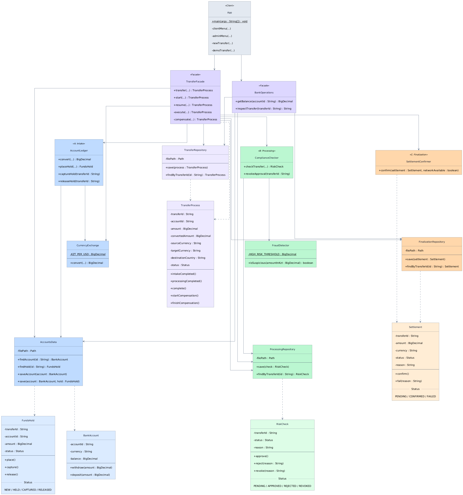

# Online Banking: Facade Pattern

Assignment 4. A console program for a transfer through three independent subsystems using two facades. One is for user; another for admin.

## Run

Java 21. From repository root:

```bash
cd OnlineBanking
./gradlew run --console=plain
./gradlew test
```

The test command also generates coverage: `app/build/reports/jacoco/test/html/index.html`.
Test results: `app/build/reports/tests/test/index.html`.

## Architecture

- A: Intake. Reserves money and converts currency. Classes: `BankAccount`, `FundsHold`, `AccountLedger`, `CurrencyExchange`, `AccountsData`.
- B: Processing. Checks the destination country and suspicious amounts. Classes: `RiskCheck`, `ComplianceChecker`, `FraudDetector`, `ProcessingRepository`.
- C: Finalization. Simulates settlement confirmation. Classes: `Settlement`, `SettlementConfirmer`, `FinalizationRepository`.
- TransferFacade. Runs A => B => C, compensates failed transfers and resumes saved transfers.
- BankOperations. Shows balances and saved transfer states without changing them.
- TransferProcess / TransferRepository. Hold and save the overall progress.
- App. Reads input, calls the facades and displays results. Normal and start-only-A transfers share the same input method.

Subsystems do not depend on each other. Each has its own entity, status transitions, business rules and JSON storage in `app/data/`. B failure compensates A. C failure compensates B, then A. Insufficient funds are handled with `InsufficientFundsException`.

Client menu options 3 and 4 trigger B and C failures. Option 5 calls `TransferFacade.start(...)` and runs only A, saving `HELD` and `PENDING_B`. Copy the ID, inspect it in the admin menu, exit and restart the app. Resume transfer continues B and C without reserving money twice.

## Unit tests: F.I.R.S.T.

- Fast: tests run locally without external services.
- Independent: persistence tests use their own `@TempDir` and start with known data.
- Repeatable: fixed inputs and isolated files make results repeatable.
- Self-validating: JUnit assertions check the results automatically.
- Timely: tests were updated with recent code changes; some earlier tests were added in separate commits.

Tests cover success, both compensation depths, insufficient funds and reopening storage mid-chain. `assertSavedState(...)` is a domain-specific test helper. `AccountLedgerTest`, `ComplianceCheckerTest` and `SettlementConfirmerTest` demonstrate the subsystems without a facade.

Last checked: 74 tests passed, 85.28% overall line coverage. Each subsystem and the facade package exceeds 80% line coverage, measured with JaCoCo.

## Principle of Least Knowledge

Before: the client calls the subsystems itself. This fragment assumes the subsystem objects exist and the transfer succeeds:

```java
String id = "EXAMPLE-001";
ledger.placeHold(id, "ACC-001", new BigDecimal("90000"));
checker.checkTransfer(id, new BigDecimal("90000"), "US");
Settlement settlement = new Settlement(id, new BigDecimal("200.00"), "USD");
settlements.save(settlement);
confirmer.confirm(settlement, true);
settlements.save(settlement);
ledger.captureHold(id);
```

These objects are `AccountLedger`, `ComplianceChecker`, `FinalizationRepository` and `SettlementConfirmer`. Without a facade, the client must also handle saved progress and compensation.

After: the client calls one facade method:

```java
TransferFacade facade = new TransferFacade();
TransferProcess result = facade.transfer(
        "EXAMPLE-001", "ACC-001", new BigDecimal("90000"),
        "USD", "US", true
);
```

The client no longer needs to know the internal call order or compensation steps.

## Facade vs Adapter

Facade gives the client one operation over several subsystems. Our `TransferFacade` coordinates reserving money, checking the transfer and confirming settlement. `BankOperations` provides a smaller inspection interface.

Adapter changes an existing interface to match another expected interface. We need to coordinate operations, not convert interfaces, so Facade is used.

## Manual reset

Stop the program. In `app/data/accounts.json`, keep the accounts and set `holds` to `{}`. Restore balances: ACC-001 and DEMO-KZT = 2,000,000 KZT each; ACC-002 = 3,000 USD; ACC-003 = 50,000 KZT.

Also reset `risk-checks.json` to `{"checks": {}}`, `settlements.json` to `{"settlements": {}}`, and `transfers.json` to `{"transfers": {}}`. Reset all four files together; do not leave files blank. Back up data first if needed.


## UML 

