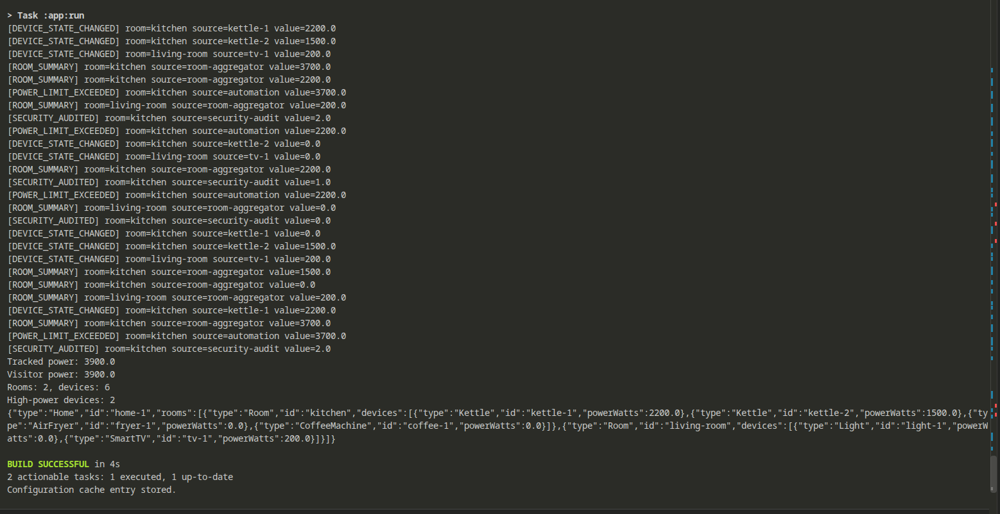

# Assignment 6 - Smart Home

## Run

Java 17, JUnit 5, Gradle wrapper. From the repository root:

```bash
cd SmartHouse
./gradlew run --args="3 3"
./gradlew test
```

Arguments: thread count (minimum 3), events per producer (minimum 1). Both default to 3. There are always three producers: two kettles and one SmartTV. The suite contains 15 tests, including 4 threads × 1,000 events.

## Design decisions

- **Observer:** two independent device sources and five listeners. Immutable events are pushed directly to listeners, avoiding queries to the source. Subscriptions are per event type. `RoomAggregator` is both Observer and Subject, republishing room totals.
- **Visitor:** `Home → Room → devices`, with five device types. `accept` provides double dispatch. Visitors control traversal to combine child results differently while keeping operation logic outside models. The four operations are power calculation, accumulated statistics, filtering, and manual nested JSON export.
- **Integration:** an overload triggers `FilterVisitor` on the affected room only. The number of matching devices is published as a new event.
- **Concurrency:** a configurable `ExecutorService`, snapshot listener lists, synchronized shared maps, volatile device power, and atomic statistics. Subscription changes affect subsequent notification loops. Shutdown waits for submitted tasks; timeouts interrupt unfinished work and report failure.
- **Composition:** `App` creates and connects dependencies through constructors. No lazy initialization in business code.

### Trade-off proof

[13c45f9 — new visitor](https://github.com/satiristica/software-design-patterns/commit/13c45f96c06a15510f2eeb4790f6734a2d3f375a)

Changed files: `JsonVisitor.java`, `VisitorTest.java`. JSON export was added without changing any element class or existing visitor.

[eefb721 — new element](https://github.com/satiristica/software-design-patterns/commit/eefb7217dd5a80bf4ec10c1411fd2b67ae33496f)

Changed files: `CoffeeMachine.java`, `Visitor.java`, `PowerVisitor.java`, `StatisticsVisitor.java`, `FilterVisitor.java`, `JsonVisitor.java`, `App.java`, `VisitorTest.java`.

A new element required updating the visitor interface and every visitor. Visitor suits stable element types with frequently added operations; frequent new device types would make these updates costly.


[UML](https://github.com/satiristica/software-design-patterns/blob/main/SmartHouse/umlka.png)


### Desired Output 

For args "4 3": 

